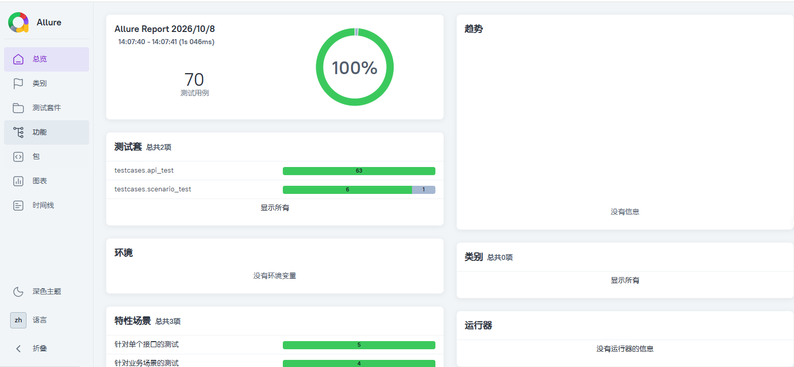

# pytestDemo

本项目是一个基于 **Python + Pytest + Requests + YAML + Allure** 的接口自动化测试框架，专门针对 [flaskDemo](https://github.com/Alexander-WH/flaskDemo) 后端接口项目进行自动化测试。

框架采用**分层设计**与**数据驱动**模式，实现了接口封装、关键字组装、测试数据管理、前置/后置数据清理，并最终生成直观可视化的 Allure 测试报告。

## 技术选型

- **测试框架**：Pytest
- **HTTP 客户端**：Requests
- **数据驱动**：PyYAML（管理测试数据）
- **动态数据**：Faker（生成随机手机号、用户名等）
- **数据库校验**：PyMySQL（用于前置/后置数据清理）
- **测试报告**：Allure-pytest + Allure Commandline

## 项目结构

- `api/`：接口封装层，将 HTTP 接口封装为 Python 方法
- `common/`：公共工具类
  - `logger.py`：日志记录模块
  - `mysql_operate.py`：MySQL 数据库操作封装
  - `read_data.py`：YAML/INI/JSON 文件读取工具
- `config/`：配置文件目录
  - `setting.example.ini`：配置文件模板（需复制为 setting.ini 后填入真实密码）
- `core/`：核心底层封装
  - `rest_client.py`：Requests 请求二次封装
  - `result_base.py`：自定义断言结果返回类
- `data/`：测试数据文件（YAML 格式，实现数据与代码分离）
- `operation/`：关键字封装层，将多个 Python 接口组装成业务关键字
- `testcases/`：测试用例层
  - `api_test/`：针对单个接口的测试
  - `scenario_test/`：针对业务场景的测试（如注册-登录-修改）
- `pytest.ini`：Pytest 配置文件
- `requirements.txt`：项目依赖清单

## 环境要求

- Python 3.8+（推荐 3.10 或 3.11，同样做了3.12+的适配，具体版本自行测试）
- MySQL 5.7+ 或 8.0
- Redis 服务（默认端口 6379）
- Allure 环境（需提前安装 Java 1.8+ 并配置环境变量）
- **前置条件**：必须先在本地启动 `flaskDemo` 后端项目（端口 9999）

## 项目部署

### 1. 安装依赖
在项目根目录下，执行以下命令安装依赖：
```bash
pip install -r requirements.txt
```

### 2. 修改配置

1. 进入 `config/` 文件夹，复制 `setting.example.ini`，并重命名为 `setting.ini`。
2. 打开 `setting.ini`，填入你本机的 MySQL 密码（注意，测试框架需要直连数据库进行数据清理）：

```ini
[mysql]
MYSQL_HOST = 127.0.0.1
MYSQL_PASSWD = your_mysql_password_here
MYSQL_DB = test
```

### 3. 运行测试

确保 `flaskDemo` 的后端服务已经在 `http://127.0.0.1:9999` 端口运行，然后执行：

```bash
# 运行全部用例，并生成 Allure 原始数据
pytest --alluredir=./allure-results --clean-alluredir

# 或者只运行某个特定模块
pytest testcases/api_test/test_01_get_user_info.py
```

### 4. 查看测试报告

测试执行完毕后，在终端输入以下命令启动 Allure 服务，浏览器会自动弹出报告页面：

```bash
allure serve ./allure-results
```

*(如果想生成静态 HTML 报告发给他人，可执行：allure generate ./allure-results -o ./allure-report --clean，然后直接双击打开 index.html)*

## 核心亮点

1. **数据驱动（DDT）**：所有测试数据通过 `data/` 目录下的 YAML 文件管理，便于维护和扩展。
2. **数据清理与隔离**：利用 Pytest Fixture 机制，在测试用例执行前后自动处理脏数据（如清理冲突的手机号），保证用例可无限次重复执行。
3. **动态造数**：集成 Faker 库，在批量注册接口测试中动态生成随机账号，规避唯一键冲突。
4. **分层架构**：清晰划分 API 层、Operation 层、Testcase 层，降低代码耦合度。
5. **可视化报告**：集成 Allure，报告包含请求步骤、响应数据、断言详情以及缺陷分类统计。

## 测试报告效果展示

> 
